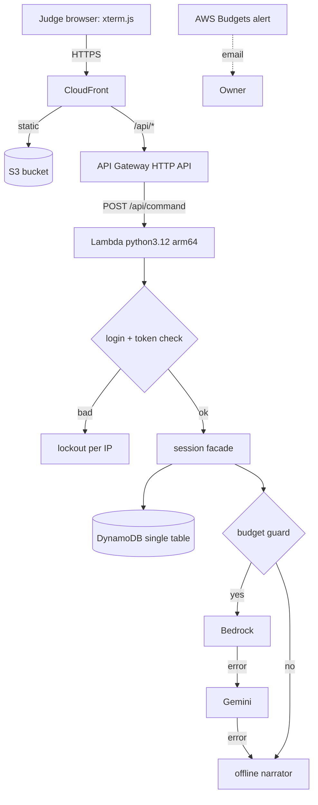

# Design: serverless AWS, LLM chain and state

Part of [`design.md`](design.md). Decisions: ADR 0006, 0007, 0009, 0010.

## Deployment

- **One template:** `infra/template.yaml` (AWS SAM) defines Lambda, HTTP API, table, S3
  bucket, CloudFront (origin S3 plus `/api/*` to the API) and the Budgets alert.
  `sam deploy` publishes it; steps are in `docs/despliegue-aws.md`.
- **Package:** `make package` (task 14.3) builds a `.zip` with `uv pip install --target
  --python-platform aarch64-manylinux2014` for `pydantic` and `pyyaml`, plus `src/` and
  `stories/`. `boto3` is not bundled (Lambda runtime has it).
- **Cold start:** 1-3 s on the first request after idle; the web client shows the modem
  "dialing". Provisioned concurrency is not used (cost).
- **Region and access:** the user picks the region, supplies AWS credentials in their own
  terminal (never in the repo) and enables Bedrock model access there.
- **Fallback plan:** if the serverless deploy is not working by Sun 29 Nov, run the same code on
  a Lightsail instance (ADR 0010). Telnet real stays local either way.
- **Wallet protection, in order:** login and token, per-session cap (token counter), global
  daily cap (atomic DynamoDB counter, exact, survives restarts), offline fallback, reserved
  Lambda concurrency, AWS Budgets alert. The alert only notifies, so the caps are the hard barrier.

## HTTP schema (pydantic, `extra="forbid"`)
```python
class CommandRequest(BaseModel):
    action: Literal["login", "command"]
    token: str | None = None  # absent on login
    user: str | None = Field(None, max_length=64)  # login only
    password: str | None = Field(None, max_length=128)  # login only
    text: str = Field("", max_length=200)  # player text: data, never policy


class CommandResponse(BaseModel):
    ok: bool
    output: str  # formatted 80-column ANSI text, CRLF, UTF-8
    token: str | None  # fresh signed token (login and each command)
    baud: int  # 0 = unlimited; the browser paces bytes at baud / 10
    carrier_dropped: bool
    ending: bool  # victory, defeat or call time over
    error: Literal["bad_login", "locked", "bad_token", "bad_request"] | None
```
The token is `base64url(payload).HMAC-SHA256`, with payload `{handle, phase, turns_used,
llm_calls, exp}`. The secret is `AUTH_SECRET` (env or SSM). Verification uses
`hmac.compare_digest`; a short lifetime (30 min) bounds idle time. The game state itself
is never in the token: it lives in `SAVE#<handle>`.

## Client-side baud pacing
`static/terminal.js` writes each response to xterm.js in chunks of `baud / 10` bytes
per second (`baud` comes from the response; 0 writes at once). It also prints the fake
banner (`Trying... Connected to ... Escape character is '^]'`) and, on `carrier_dropped`,
prints `NO CARRIER`, clears the token and returns to the login. The server never sleeps.

## Single-table data model
Table `STATE_TABLE_NAME`, key `pk` (string), no sort key, `PAY_PER_REQUEST`, TTL attribute `ttl`.

| `pk` | Attributes | TTL | Use |
|---|---|---|---|
| `SAVE#<handle>` | `save` (JSON of `SaveGame`) | 30 days | game save, carrier drop resume |
| `BUDGET#<YYYY-MM-DD>` | `calls` (number) | 2 days | atomic daily LLM calls |
| `AUTH#<ip>` | `failures`, `blocked_until` | 1 hour | progressive lockout |

- `try_consume`: `UpdateItem` `ADD calls :one` with `ConditionExpression
  attribute_not_exists(calls) OR calls < :cap`; a failed condition means the cap is reached.
- `register_failure`: `UpdateItem` increments `failures` and sets `blocked_until` to
  `now + min(2**failures, 900)` seconds; a success deletes the item.
- Handles are validated (`[A-Za-z0-9_-]{1,16}`) before they touch a key.

## LLM provider chain
`narrator/chain.py` tries providers in order and returns the first valid answer:
`BedrockProvider` (Converse API, `BEDROCK_MODEL_ID`) -> `GeminiProvider` (`google-genai`,
`GEMINI_MODEL`) -> `OfflineNarrator`. `LLM_PROVIDER` picks the start (`bedrock`, `gemini`,
`offline`); a missing credential, a cap, a timeout (8 s) or invalid output skips to the next.
Model ids are env-only and not verified until tasks 13.1 and 13.2 list them with the real
account and key (`python -m telnet_tales.narrator.list_models`). A 404 or access denied
means change the env var. Gemini notes (conflicting sources, SDK call) are in ADR 0006.
`LLMBudgetGuard` wraps the chain: it asks `DailyBudget.try_consume` before each LLM call.
Tests inject fake clients and never touch the network (R4.7).
