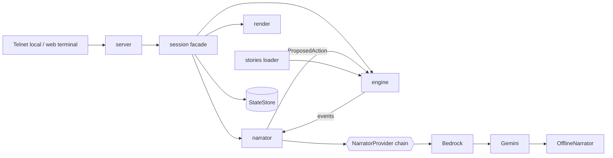
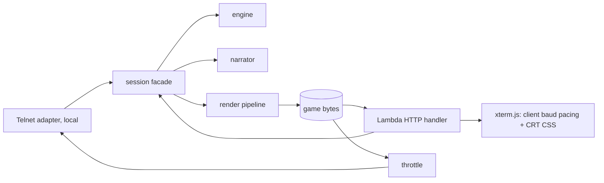

# Design: The Telnet Tales

## Overview
A pure rules engine surrounded by adapters. Data flows one way: input text ->
(optional LLM interpretation) -> engine validation -> engine state change ->
(optional LLM narration) -> renderer -> bytes (paced by the client or the Telnet writer).
Deployment, LLM chain, state table and HTTP schema: [`design-aws.md`](design-aws.md).

## Module diagram


## Packages and why they are separate
| Package | Responsibility | Rule |
|---------|----------------|------|
| `engine` | State, dice, actions, combat, carrier drop decision | No I/O, no LLM, no clock |
| `narrator` | Provider interface, prompts, parsing, offline fallback | Cannot import state mutators |
| `stories` | YAML load, schema, graph validator | Returns validated models |
| `server` | Session facade, Lambda handler, local Telnet, state stores | Only place with I/O |
| `render` | Word wrap, ANSI themes, boxes, i18n, throttle | Only place with escape codes |

`render` is its own package (not part of `server`) because wrapping, color and
baud pacing are testable pure functions that both Telnet and web share. The browser repeats the baud pacing in JS; the byte content never changes.

## Data models (Pydantic v2, frozen where possible)
- `Stats(wits, brawn, luck: int 0..5)`; `Player(handle, hit_points, max_hit_points, stats, inventory: tuple[str, ...])`.
- `GameState(seed, draw_count, player, node_id, flags, combat: CombatState | None, turn, events)`.
- `StoryNode(id, title, text, exits: list[Exit], items: list[str], encounter: str | None, is_ending: bool)`.
- `Exit(label, target_id, requirement: Requirement | None)`; `Requirement(item | stat+minimum)`.
- `Encounter(id, name, hit_points, attack_bonus, damage, flavor_hint)`.
- `ProposedAction(action_type: Literal[...], target: str | None)` with `extra="forbid"`.
- `ActionResult(ok, rejection: Rejection | None, events: tuple[GameEvent, ...])`.
- `SaveGame(version, state: GameState)`: validated snapshot that a `SaveStore` persists as JSON.
- `CommandRequest` / `CommandResponse`: the HTTP schema (see `design-aws.md`).
- `NarrationContext(node_title, node_text, visible_exits, visible_items, public_stats, recent_events)`.

## Key interfaces
```python
class NarratorProvider(Protocol):
    async def narrate(self, context: NarrationContext) -> str: ...
    async def interpret(self, text: str, context: NarrationContext) -> ProposedAction: ...


def apply_action(
    state: GameState, action: ProposedAction, story: Story
) -> tuple[GameState, ActionResult]: ...
```
```python
class SaveStore(Protocol):  # one tiny Protocol per file; StateStore composes three
    def load(self, player_id: str) -> SaveGame | None: ...
    def save(self, player_id: str, save_game: SaveGame) -> None: ...
    def delete(self, player_id: str) -> None: ...
```
`apply_action` returns a new state (immutability makes property tests easy).

## State store
Session code talks only to `StateStore` = `SaveStore` + `DailyBudget` + `LoginAttempts`
(ADR 0009). Implementations: `MemoryStore` (tests), `FileStore` (local play, `.bad` quarantine
for corrupt files) and `DynamoStateStore` (one table, see `design-aws.md`). `load` returns
`None` when there is no save, it expired, or it is corrupt.

## Story files and the graph validator
Story vocabulary is the same everywhere (design, requirements, YAML, validator):
node `id`, `exits`, exit `target_id`, node `is_ending`. A story file is a map
`{start, nodes: [...]}` (a bare list of nodes is also accepted; the first node
is then the start).
`scripts/validate_story_graph.py` (package `scripts/story_validation/`, stdlib +
PyYAML, no game imports) checks every file under `stories/`:
unknown `target_id` (error), node without exits and without `is_ending: true`
(error), any text or ASCII-art line wider than 80 display columns (error),
unreachable nodes (warning). It runs in `make scripts` and in the
`validate-story-graph` hook. The runtime validator in `stories/graph.py` (task 3.3) uses the same names.

## Two transports, one pipeline
The local Telnet adapter and the Lambda HTTP handler are thin adapters over the same
session facade (R6.5, R7.5-R7.7):

- `render/pipeline.py`: one function from a view model to `bytes`: wrap at 80, 16
  ANSI colors by role, boxes (UTF-8/CP437/ASCII), i18n. Always CRLF.
- `server/session.py`: the facade; stateless per command, state in `StateStore` and the token.
- `render/throttle.py` only delays Telnet writes; the web pacing is JS and never touches bytes.
- **P14** proves it: the same seed and command script through the Telnet adapter
  (fake writer) and the Lambda handler (direct call) give equal game byte streams, plus a golden file.

## LLM, deployment and cost protection
Moved to [`design-aws.md`](design-aws.md): provider chain Bedrock -> Gemini -> offline
(ADR 0006), serverless AWS diagram, single-table data model, request/response schema,
login token and wallet protection (ADR 0007, 0009, 0010).

## Error handling
- LLM: timeout, HTTP error, JSON error or schema error -> next provider in the chain, last the offline narrator, + counter in logs.
- Story file errors: aggregated list, startup refused.
- Save errors: corrupt file renamed `.bad`, new game started. A DynamoDB error on `save` is logged and the turn answers with a retry message; no state is lost silently.
- Network: client disconnect = same path as carrier drop without the message; the next login resumes from the save.

## Correctness properties (for hypothesis)
- **P1 Dice range:** for any seed and modifier, `roll_d20` is in 1..20 and the check outcome equals the rule.
- **P2 Determinism:** same seed and same action list give an identical final `GameState`.
- **P3 Rejection purity:** a rejected action returns a state equal to the input.
- **P4 HP bounds:** `0 <= hit_points <= max_hit_points` after any action sequence.
- **P5 Inventory bound:** inventory size <= 8 and has no duplicates of unique items.
- **P6 Graph validity:** a story that passes validation has every node reachable from start and a path to a final node.
- **P7 Allow-list:** any `ProposedAction` with an unlisted type is rejected, never applied.
- **P8 Narrator isolation:** running any narrator (fuzzed outputs) never changes `GameState`.
- **P9 Width:** for any text, theme and charset, every rendered line has visible width <= 80.
- **P10 Throttle:** total simulated delay for N bytes equals `N * 10 / baud` within rounding; baud 0 gives 0.
- **P11 Save round trip:** `load(save(state)) == state` (JSON serialization of any valid `GameState`).
- **P12 Carrier drop resume:** after drop + save + load, the next round equals the round that would have followed with no drop.
- **P13 i18n parity:** `en` and `es-ES` catalogs have equal key sets.
- **P14 Transport parity:** for any seed and command script, the Telnet adapter and the Lambda handler emit identical game bytes (golden file for one fixed script too).
- **P15 Budget fallback:** for any call sequence, provider calls never exceed the session cap or the daily cap (`MemoryStore`, also under concurrent increments); beyond it, with no provider or on error, the chain ends at the offline narrator.
- **P16 Login gate:** only the exact credentials get a valid token; a tampered or expired token is refused; failures per IP give a monotonic lockout (never shorter after another failure).

- **P17 StateStore contract:** for any valid `GameState` and player id, `load` after `save` returns an equal `SaveGame`; unknown id gives `None`; `delete` is idempotent. Holds for `MemoryStore`, `FileStore` (`tmp_path`) and `DynamoStateStore` with a fake client.

## Testing strategy
Unit tests with concrete cases, hypothesis for P1-P17, loopback integration test for
Telnet and direct calls to the Lambda handler with the offline narrator, fake clock for
timeouts and lockout, fake Bedrock/Gemini/DynamoDB clients, no network.

## Decisions
See `docs/adr/` (0001 golden rule, 0002 Python/uv, 0003 Telnet, 0004 web terminal, 0005 offline narrator, 0006 LLM chain, 0007 public demo access, 0008 two transports one pipeline, 0009 state store, 0010 serverless AWS).
