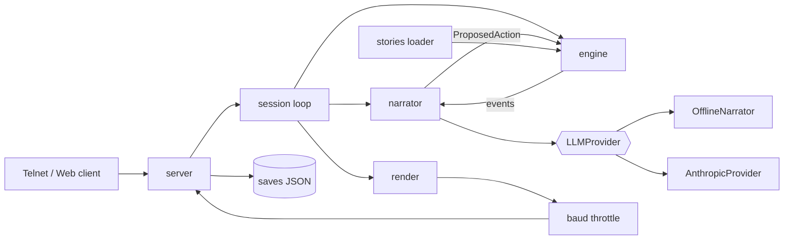

# Design: The Telnet Tales

## Overview
A pure rules engine surrounded by adapters. Data flows one way: input text ->
(optional LLM interpretation) -> engine validation -> engine state change ->
(optional LLM narration) -> renderer -> throttled bytes.

## Module diagram


## Packages and why they are separate
| Package | Responsibility | Rule |
|---------|----------------|------|
| `engine` | State, dice, actions, combat, carrier drop decision | No I/O, no LLM, no clock |
| `narrator` | Provider interface, prompts, parsing, offline fallback | Cannot import state mutators |
| `stories` | YAML load, schema, graph validator | Returns validated models |
| `server` | Telnet, WebSocket, sessions, save files | Only place with sockets |
| `render` | Word wrap, ANSI themes, boxes, i18n, throttle | Only place with escape codes |

`render` is its own package (not part of `server`) because wrapping, color and
baud pacing are testable pure functions that both Telnet and web share.

## Data models (Pydantic v2, frozen where possible)
- `Stats(wits, brawn, luck: int 0..5)`; `Player(handle, hit_points, max_hit_points, stats, inventory: tuple[str, ...])`.
- `GameState(seed, draw_count, player, node_id, flags, combat: CombatState | None, turn, events)`.
- `StoryNode(id, title, text, exits: list[Exit], items: list[str], encounter: str | None, final: bool)`.
- `Exit(label, target, requirement: Requirement | None)`; `Requirement(item | stat+minimum)`.
- `Encounter(id, name, hit_points, attack_bonus, damage, flavor_hint)`.
- `ProposedAction(action_type: Literal[...], target: str | None)` with `extra="forbid"`.
- `ActionResult(ok, rejection: Rejection | None, events: tuple[GameEvent, ...])`.
- `NarrationContext(node_title, node_text, visible_exits, visible_items, public_stats, recent_events)`.

## Key interfaces
```python
class NarratorProvider(Protocol):
    async def narrate(self, context: NarrationContext) -> str: ...
    async def interpret(self, text: str, context: NarrationContext) -> ProposedAction: ...


def apply_action(
    state: GameState, action: ProposedAction, story: Story
) -> tuple[GameState, ActionResult]: ...
```
`apply_action` returns a new state (immutability makes property tests easy).

## Error handling
- LLM: timeout, HTTP error, JSON error or schema error -> offline narrator + counter in logs.
- Story file errors: aggregated list, startup refused.
- Save errors: corrupt file renamed `.bad`, new game started.
- Network: client disconnect = same path as carrier drop without the message.

## Correctness properties (for hypothesis)
- **P1 Dice range:** for any seed and modifier, `roll_d20` is in 1..20 and the check outcome equals the rule.
- **P2 Determinism:** same seed and same action list give an identical final `GameState`.
- **P3 Rejection purity:** a rejected action returns a state equal to the input.
- **P4 HP bounds:** `0 <= hit_points <= max_hit_points` after any action sequence.
- **P5 Inventory bound:** inventory size <= 8 and has no duplicates of unique items.
- **P6 Graph validity:** a story that passes validation has every node reachable from start and a path to a final node.
- **P7 Allow-list:** any `ProposedAction` with an unlisted type is rejected, never applied.
- **P8 Narrator isolation:** running any narrator (fuzzed outputs) never changes `GameState`.
- **P9 Width:** for any text, theme and charset, every rendered line has visible width <= 80.
- **P10 Throttle:** total simulated delay for N bytes equals `N * 10 / baud` within rounding; baud 0 gives 0.
- **P11 Save round trip:** `load(save(state)) == state`.
- **P12 Carrier drop resume:** after drop + save + load, the next round equals the round that would have followed with no drop.
- **P13 i18n parity:** `en` and `es-ES` catalogs have equal key sets.

## Testing strategy
Unit tests with concrete cases, hypothesis for P1-P13, loopback integration
tests for Telnet and WebSocket with the offline narrator, fake clock for baud
and timeouts, fake provider for LLM failures.

## Decisions
See `docs/adr/` (0001 golden rule, 0002 Python/uv, 0003 Telnet, 0004 web terminal, 0005 narrator fallback and provider).
