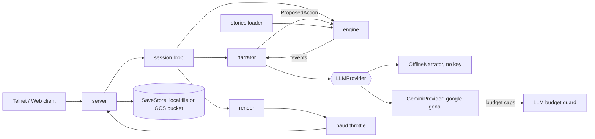
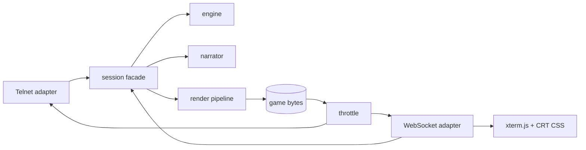
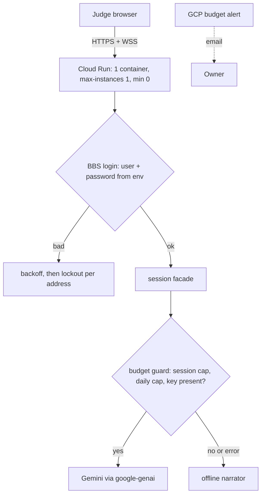

# Design: The Telnet Tales

## Overview
A pure rules engine surrounded by adapters. Data flows one way: input text ->
(optional LLM interpretation) -> engine validation -> engine state change ->
(optional LLM narration) -> renderer -> throttled bytes.

## Module diagram


## Packages and why they are separate
| Package | Responsibility | Rule |
|---------|----------------|------|
| `engine` | State, dice, actions, combat, carrier drop decision | No I/O, no LLM, no clock |
| `narrator` | Provider interface, prompts, parsing, offline fallback | Cannot import state mutators |
| `stories` | YAML load, schema, graph validator | Returns validated models |
| `server` | Telnet, WebSocket, sessions, save files | Only place with sockets |
| `render` | Word wrap, ANSI themes, boxes, i18n, throttle | Only place with escape codes |

`render` is its own package (not part of `server`) because wrapping, color and
baud pacing are testable pure functions that both Telnet and web share.

## Data models (Pydantic v2, frozen where possible)
- `Stats(wits, brawn, luck: int 0..5)`; `Player(handle, hit_points, max_hit_points, stats, inventory: tuple[str, ...])`.
- `GameState(seed, draw_count, player, node_id, flags, combat: CombatState | None, turn, events)`.
- `StoryNode(id, title, text, exits: list[Exit], items: list[str], encounter: str | None, is_ending: bool)`.
- `Exit(label, target_id, requirement: Requirement | None)`; `Requirement(item | stat+minimum)`.
- `Encounter(id, name, hit_points, attack_bonus, damage, flavor_hint)`.
- `ProposedAction(action_type: Literal[...], target: str | None)` with `extra="forbid"`.
- `ActionResult(ok, rejection: Rejection | None, events: tuple[GameEvent, ...])`.
- `SaveGame(version, state: GameState)`: validated snapshot that a `SaveStore` persists as JSON.
- `NarrationContext(node_title, node_text, visible_exits, visible_items, public_stats, recent_events)`.

## Key interfaces
```python
class NarratorProvider(Protocol):
    async def narrate(self, context: NarrationContext) -> str: ...
    async def interpret(self, text: str, context: NarrationContext) -> ProposedAction: ...


def apply_action(
    state: GameState, action: ProposedAction, story: Story
) -> tuple[GameState, ActionResult]: ...
```
```python
class SaveStore(Protocol):
    def load(self, player_id: str) -> SaveGame | None: ...
    def save(self, player_id: str, save_game: SaveGame) -> None: ...
    def delete(self, player_id: str) -> None: ...
```
`apply_action` returns a new state (immutability makes property tests easy).

## Save store
Session code talks only to the `SaveStore` Protocol (three methods, above).
`LocalFileSaveStore` (default) writes one JSON per handle on local disk; it is the
only store in tests and local play. `GcsSaveStore` is optional and chosen only when
`GCS_SAVE_BUCKET` is set; it imports `google-cloud-storage` lazily and the package
enters `pyproject` only in task 14.11. `load` returns `None` when there is no save
or the save is corrupt (the corrupt file is kept as `.bad`). See ADR 0009.

## Story files and the graph validator
Story vocabulary is the same everywhere (design, requirements, YAML, validator):
node `id`, `exits`, exit `target_id`, node `is_ending`. A story file is a map
`{start, nodes: [...]}` (a bare list of nodes is also accepted; the first node
is then the start).
`scripts/validate_story_graph.py` (package `scripts/story_validation/`, stdlib +
PyYAML, no game imports) checks every file under `stories/`:
unknown `target_id` (error), node without exits and without `is_ending: true`
(error), any text or ASCII-art line wider than 80 display columns (error),
unreachable nodes (warning). It runs in `make scripts` and in the
`validate-story-graph` hook. The runtime validator in `stories/graph.py` (task 3.3) uses the same names.

## Two transports, one pipeline
Telnet and the web terminal are thin adapters over the same code (R6.5, R7.5-R7.7):

- `render/pipeline.py`: one function from a view model to `bytes`: wrap at 80, 16
  ANSI colors by role, boxes (UTF-8/CP437/ASCII), i18n. Always CRLF.
- `server/session.py`: the facade. It talks to a `Transport` Protocol
  (`read_line`, `write_bytes`, `close`) and knows nothing else about the client.
- `render/throttle.py` only delays writes; the bytes are the same at any baud.
- Adapters add only protocol framing (Telnet option negotiation, WebSocket frames).
- The CRT look (scanlines, glow, font) is CSS/JS in `static/`; xterm.js receives
  the same bytes as `nc`.
- **P14** proves it: the same seed and command script run through both adapters
  (fake telnetlib3 writer, fake WebSocket) must give equal game byte streams.

## LLM provider
Provider interface in `narrator/`. `OfflineNarrator` is deterministic and needs no
key: it is the only narrator in tests, CI and offline demos (R4.5, R4.6).
`GeminiProvider` uses the `google-genai` SDK (named here; added to `pyproject`
only by task 13.1). The key comes from `GEMINI_API_KEY`; Vertex AI is optional with
the same SDK. Tests inject a fake client and make no network calls (R4.7).
The model id is always read from the env var `GEMINI_MODEL` and never written in
code, so Cloud Run config can change it without a redeploy. The default in
`.env.example` is only a starting value. The exact available id is **not** verified
until task 13.1 lists models with the real key (`client.models.list()`, shown by
`python -m telnet_tales.narrator.list_models`). A 404 on the model means change
`GEMINI_MODEL`, not code; the turn then uses the offline narrator. See ADR 0006.
`LLMBudgetGuard` wraps any provider: per-session cap (30) and daily cap (500).
A cap, a missing key, a timeout or an invalid reply sends that turn to the
offline narrator, with no error shown (R13.4, R13.5).

## Deployment and cost protection

- **Persistence:** the container disk is ephemeral and the instance scales to zero
  after about 15 minutes idle. Without `GCS_SAVE_BUCKET`, Carrier Drop resume works
  only while the instance is warm; a judge returning next day starts again. With the
  bucket, saves survive. See ADR 0009.
- **Container:** one `Dockerfile`, non-root, listens on `$PORT` (web only). No
  secrets in the image; user, password and key come from env or Secret Manager.
- **Cloud Run:** scale to zero (cost 0 when idle), `max-instances 1` (one process,
  so in-memory counters are exact), WebSocket supported. A request timeout (up to
  60 min) closes the socket: the client sees a normal carrier drop and resumes
  from the save. Raw Telnet is not possible on Cloud Run; it runs locally.
- **Login:** shown inside the session, so it is part of the BBS fiction and is the
  same on both transports. `hmac.compare_digest` on both fields, one generic error.
  Failures per address back off (1, 2, 4... seconds, capped) and lock out for a
  window. Passwords are never logged. `shortcut`: in-memory state resets on
  restart; with one instance that is accepted.
- **Wallet protection, in order:** login gate, per-session call cap, global daily
  cap, offline fallback, GCP budget alert. The alert only notifies, so the app caps
  are the hard barrier.
- Credentials go in the Devpost testing-instructions field. See ADR 0007.

## Error handling
- LLM: timeout, HTTP error, JSON error or schema error -> offline narrator + counter in logs.
- Story file errors: aggregated list, startup refused.
- Save errors: corrupt file renamed `.bad`, new game started. A GCS error on `load` or `save` is logged and the game goes on in memory.
- Network: client disconnect = same path as carrier drop without the message.

## Correctness properties (for hypothesis)
- **P1 Dice range:** for any seed and modifier, `roll_d20` is in 1..20 and the check outcome equals the rule.
- **P2 Determinism:** same seed and same action list give an identical final `GameState`.
- **P3 Rejection purity:** a rejected action returns a state equal to the input.
- **P4 HP bounds:** `0 <= hit_points <= max_hit_points` after any action sequence.
- **P5 Inventory bound:** inventory size <= 8 and has no duplicates of unique items.
- **P6 Graph validity:** a story that passes validation has every node reachable from start and a path to a final node.
- **P7 Allow-list:** any `ProposedAction` with an unlisted type is rejected, never applied.
- **P8 Narrator isolation:** running any narrator (fuzzed outputs) never changes `GameState`.
- **P9 Width:** for any text, theme and charset, every rendered line has visible width <= 80.
- **P10 Throttle:** total simulated delay for N bytes equals `N * 10 / baud` within rounding; baud 0 gives 0.
- **P11 Save round trip:** `load(save(state)) == state` (JSON serialization of any valid `GameState`).
- **P12 Carrier drop resume:** after drop + save + load, the next round equals the round that would have followed with no drop.
- **P13 i18n parity:** `en` and `es-ES` catalogs have equal key sets.
- **P14 Transport parity:** for any seed and command script, the Telnet adapter and the web adapter emit identical game bytes (golden file for one fixed script too).
- **P15 Budget fallback:** for any call sequence, calls to the provider never exceed the session or daily cap; beyond it (or with no key) the offline narrator answers.
- **P16 Login gate:** only the exact credentials pass; after N failures from one address the next attempt is refused until the backoff window ends.

- **P17 SaveStore contract:** for any valid `GameState` and player id, `load` after `save` returns an equal `SaveGame`; `load` of an unknown id is `None`; `delete` is idempotent (twice equals once) and a later `load` is `None`. Holds for `LocalFileSaveStore` (`tmp_path`) and for `GcsSaveStore` with a fake client.

## Testing strategy
Unit tests with concrete cases, hypothesis for P1-P17, loopback integration
tests for Telnet and WebSocket with the offline narrator, fake clock for baud
and timeouts, fake provider and fake `google-genai` client for LLM failures, no network.

## Decisions
See `docs/adr/` (0001 golden rule, 0002 Python/uv, 0003 Telnet, 0004 web terminal, 0005 offline narrator, 0006 Gemini provider, 0007 public demo on Cloud Run, 0008 two transports one pipeline, 0009 save store).
