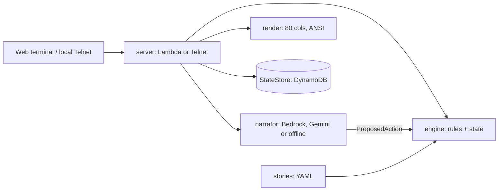

# The Telnet Tales

> Summoning the ghost of 1980s dial-up BBS doors to run AI-powered interactive
> fiction. Connect at 2400 baud, explore ASCII labyrinths, and pray the SysOp
> doesn't drop your carrier mid-combat.

Kiroween 2026 entry, category **Resurrection**. Built between 30 Oct and 4 Dec 2026
with [Kiro](https://kiro.dev). No pre-existing code was reused.

**Status:** foundation committed (steering, specs, hooks, tooling). Game code
follows the plan in [`tasks.md`](.kiro/specs/telnet-tales/tasks.md).

_Screenshot: coming with the demo (task 16.1)._

## The idea
A text adventure that behaves like a Telnet BBS door game: login screen, SysOp
bulletins, 80 columns, green or amber phosphor, simulated modem speed. An LLM
narrates and understands free-text commands, but **the Python engine is the only
thing that can change the game**. The LLM proposes, the engine disposes.

Signature feature: **carrier drop.** The SysOp may cut your line mid-combat. Your
state is saved; call back and the fight resumes.

## How Kiro was used
| Kiro feature | What we did | Where |
|---|---|---|
| **Specs** | EARS requirements, design with 17 correctness properties for property tests, ordered tasks with day markers | [`.kiro/specs/telnet-tales/`](.kiro/specs/telnet-tales/) |
| **Steering** | Always-on product/tech/structure, architecture golden rule, code style, retro terminal rules, testing, git; `fileMatch` for `engine/**`; manual submission checklist | [`.kiro/steering/`](.kiro/steering/) |
| **Hooks** | `run-tests-on-save` (ruff fix + pytest), format + file-length, no-nested-loops, `validate-story-graph`, engine test reminder, task gate (`make check`), devlog reminder, `.kiro`-not-ignored guard | [`.kiro/hooks/`](.kiro/hooks/) |
| **Devlog** | `DEVLOG.md` is the build diary; steering rule `devlog.md` and hook `devlog-reminder` make the agent log each milestone and each property-test failure | [`DEVLOG.md`](DEVLOG.md) |
| **Strategy** | Vertical slice first (engine, offline narrator, renderer, Telnet) before the LLM | [`tasks.md`](.kiro/specs/telnet-tales/tasks.md) |
| **Agent rules** | Same rules for any agent | [`AGENTS.md`](AGENTS.md) |

Hooks are backed by real scripts with tests: [`scripts/`](scripts/).

## Architecture

The local Telnet adapter and the Lambda HTTP handler share one render pipeline and one session facade, so both send the same bytes. Deployment diagram: [design-aws.md](.kiro/specs/telnet-tales/design-aws.md).
Details: [design.md](.kiro/specs/telnet-tales/design.md). Spanish docs and ADRs are in [`docs/`](docs/).

## Quickstart
```bash
uv sync
make check          # ruff, mypy --strict, pytest + hypothesis, repo rules
cp .env.example .env   # optional: LLM_PROVIDER and model ids; works offline without it
```
Planned: `uv run telnet-tales` then `telnet localhost 2323` (or `nc localhost 2323`),
and the web client against a local HTTP handler. Deploy: `sam build && sam deploy`
(see [`docs/despliegue-aws.md`](docs/despliegue-aws.md); `make package` arrives with task 14.3).

## Demo and LLM
LLM chain: Amazon Bedrock first, Gemini as fallback, then a deterministic offline
narrator, with per-session and daily call caps (ADR 0006). Model ids are read only
from `BEDROCK_MODEL_ID` and `GEMINI_MODEL`; list the ids your account or key can use with
`uv run python -m telnet_tales.narrator.list_models`.
The public demo is the web terminal only, behind a login (credentials in the Devpost
testing instructions). It runs serverless on AWS: S3 + CloudFront, API Gateway HTTP API,
Lambda and DynamoDB, described by one SAM template (ADR 0010). Kiro is an AWS product
and we have AWS credits; the hackathon gives no bonus for AWS. Real Telnet runs locally
and in the video, not in the cloud. Saves live in DynamoDB with a TTL, so a carrier-drop
resume works the next day (ADR 0009). Cloud Run and Lightsail are documented alternatives.

## Rules in one glance
- The LLM never mutates state; every action is validated by the engine.
- Files under 200 lines, zero nested loops, strict typing: enforced by scripts and hooks.
- Comments and `/docs` in Spanish; game text in English.

## License
[MIT](LICENSE) (c) The Telnet Tales contributors.
