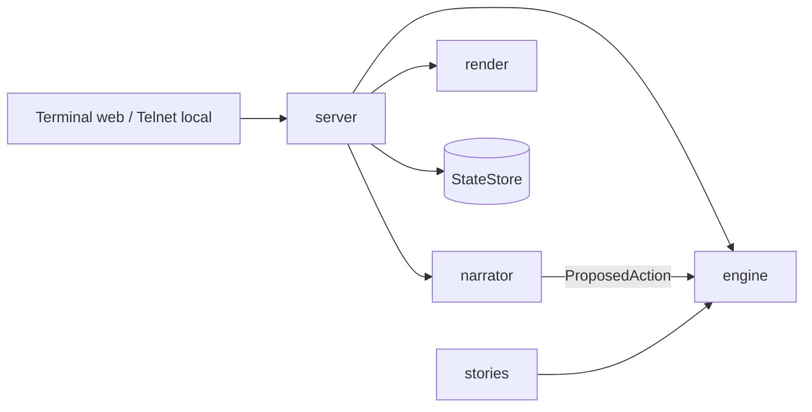

# Arquitectura

## Módulos

## Responsabilidades
| Paquete | Responsabilidad | Prohibido |
|---|---|---|
| `engine` | Estado, dados, reglas, combate, decisión de caída | I/O, reloj, LLM |
| `narrator` | Interfaz del proveedor, prompts, parseo, narrador offline | Modificar el estado |
| `stories` | Carga YAML y validación del grafo | Lógica de juego |
| `server` | Fachada de sesión, manejador Lambda, Telnet local, almacenes de estado | Reglas |
| `render` | 80 columnas, ANSI, cajas, i18n, limitador | Reglas |

`render` es un paquete propio porque ajuste de línea, color y ritmo de baudios son
funciones puras y comprobables, compartidas por Telnet y web. El navegador repite
el ritmo de baudios en JS sin cambiar los bytes.

## Flujo de un turno
texto del jugador -> `narrator.interpret` -> `engine.apply_action` (valida y aplica)
-> eventos -> `narrator.narrate` -> `render` (ajuste + color) -> respuesta HTTP (la web
pinta con ritmo de baudios) o, en Telnet local, limitador -> socket.

## Reglas de dependencia
`server` puede importar a todos. `narrator` importa tipos de `engine`, nunca
funciones que muten estado. `engine` no importa a nadie.

## Reglas de código
Ver `.kiro/steering/code-style.md`: archivos de menos de 200 líneas, funciones de
15 a 25 líneas, cero bucles anidados, comentarios en español que explican el porqué.

## Verificación
`make check` ejecuta ruff, mypy estricto, pytest (con hypothesis) y los scripts de
`scripts/`. Los hooks de `.kiro/hooks/` lanzan esas mismas comprobaciones:

| Hook | Cuándo | Qué ejecuta |
|---|---|---|
| `run-tests-on-save` | guardar `.py` en `src/` o `tests/` | `ruff check --fix` y `pytest -q` |
| Format check + file length on save | guardar `.py` | `ruff format --check` y límite de 200 líneas |
| No nested loops on save | guardar `.py` | `check_nested_loops.py` |
| `validate-story-graph` | guardar archivo en `stories/` | `validate_story_graph.py` |
| Engine change needs property tests | guardar en `engine/` | recordatorio al agente |
| `.kiro` guards | guardar `.gitignore`, inicio de sesión | `check_gitignore_kiro.py` |
| Task gate | antes y después de una tarea | `make check` |
| `devlog-reminder` | después de una tarea | recordatorio al agente: entrada en `DEVLOG.md` |

## Demo pública
Solo terminal web con usuario y contraseña, serverless en AWS (ADR 0010): S3 y CloudFront
sirven la página; `POST /api/command` va a un API Gateway HTTP API y a una Lambda sin estado;
DynamoDB guarda partidas, el contador diario de llamadas y los intentos de login (ADR 0009).
El LLM sigue la cadena Bedrock, Gemini, offline (ADR 0006), con topes por sesión y por día.
Guía de despliegue: `docs/despliegue-aws.md`.
